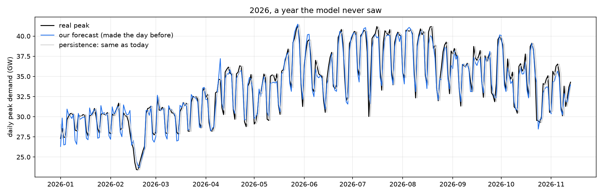
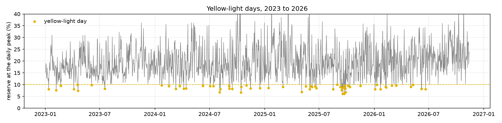

# Power Weather Taiwan (明日電力預報)

**Track:** AI + Climate
**Team:** Yu-Rui Huang (Hsinchu County American School)

**Live demo (runs in your browser):** https://curry06240624-dev.github.io/power-weather-taiwan/
**Notebook with all results:** [`power_weather.ipynb`](power_weather.ipynb)

## The problem
Every evening, the people who run Taiwan's power grid decide how much backup power to keep ready for tomorrow's peak.
If they keep too little, the spare power at the peak falls under 10% (Taipower's **yellow light**) and blackouts become
possible, as in 2021 and 2022. If they keep too much, extra fossil-fuel plants sit on standby for nothing. Both depend on
one number: **how much power Taiwan will need at tomorrow's peak.**

**Who it's for:** a grid planner at about 9 pm, deciding how many backup units to keep warm for tomorrow afternoon. A
second user is the energy manager of a factory in Taipower's demand-response programme, who decides the evening
before whether a tight day is coming. Taipower has its own, more detailed forecasts; our tool is an open, explainable
version, and a test of what public data can and cannot tell you.

## What we built
* **In:** tomorrow's weather forecast for seven big cities, tomorrow's day type from the government holiday calendar,
  and recent demand.
* **Out:** tomorrow's national peak demand in GW, with a breakdown of why (weather, day type, recent demand, growth).
* **How you'd use it:** open the [demo](https://curry06240624-dev.github.io/power-weather-taiwan/), pick any 2026 day to
  see the forecast made the evening before next to what really happened, or use "What if tomorrow is…" to change the
  temperature and the day type. Everything runs in the browser; there is no server.

## What we added
Our own idea, built for the Climate track's example user (a grid operator deciding how much backup power to keep
ready). On top of a basic forecast we added:
* **Our own data:** almost four years of Taipower's daily data (2023 to 13 November 2026), the government holiday
  calendar, and weather for seven cities weighted by population.
* **An honest test:** the test year is fed the weather **forecast made the day before**, not the weather that really
  happened.
* **Two questions of our own:** can public data warn about yellow-light days, and is demand growing faster than the
  weather explains?

## How it works
**Data.**
* Taipower publishes the daily reserve (spare power at the peak) and the reserve rate (reserve ÷ peak). Peak demand is
  therefore reserve ÷ rate. That gives **1,413 days with no gaps**. Checked against Taipower's own peak column on the
  608 days where both exist, our rebuilt numbers differ by 4.4 MW on average (0.01%).
* **Cleaning:** Taipower's full daily table has **6 reserve-rate values that are 10 times too big** (202.0% where
  reserve ÷ load gives 20.02%) and **10 electricity-use values that are 100 times too big**. We rebuild the rate ourselves
  and divide the use typos by 100. The notebook lists every one.
* **Holidays** come from the DGPA government office calendar. We mark the whole Lunar New Year break, not only its
  named days.
* **Weather** comes from Open-Meteo for Taipei, New Taipei, Taoyuan, Hsinchu, Taichung, Tainan and Kaohsiung,
  averaged by population. For training we use the weather that happened. For the test we use the forecast made one day
  earlier, which was off by 0.81 °C on average for the daily maximum.

**Model.** Ridge regression (a linear model with a small penalty) on 17 inputs:
* weather: degrees above 24 °C and above 29 °C, degrees of daily mean below 17 °C, humidity, sunshine, rain;
* day type: Saturday or Sunday off, weekday holiday, make-up workday, Lunar New Year break, Monday;
* recent demand: today's peak, last week's peak on the same weekday, whether today was a day off;
* a growth trend, plus one improvement (degrees above 29 °C on a workday).

We chose a linear model on purpose. Every weight has a plain meaning (on a workday above 29 °C, **each extra degree
adds about 720 MW**; a Sunday off takes away about 2,900 MW). A line can also go above anything seen in training,
which matters because Taiwan keeps setting new demand records.

**Split by time, never at random:** train on 2023–2024, choose settings on 2025, and test **once** on 1 January to
13 November 2026 (317 days).

## Results
Average miss on the 317 test days of 2026 (average peak: 33.9 GW):

| Method | Average miss (MW) | Average miss (%) |
|---|---:|---:|
| Baseline: tomorrow = today | 1,695 | 5.00% |
| Baseline: tomorrow = same weekday last week | 1,764 | 5.31% |
| Gradient boosting (a tree model) | 881 | 2.57% |
| Ridge, basic inputs | 613 | 1.86% |
| **Ridge + heat on workdays (our final model)** | **580** | **1.75%** |
| Final model fed the real weather (impossible in practice) | 535 | 1.62% |

Our forecast's average miss is about a third of the "same as today" guess's. Using the real day-before forecast instead of the
real weather costs only 0.13 points. The **tree model is worse** because trees can't forecast much above the highest
values they saw in training: its highest 2026 forecast was 40.3 GW, below the training record of 41.4 GW, and on the 98
hottest days of 2026 it was 676 MW too low on average, against 217 MW for ours.

**Where it fails** (the full top 10 is in the notebook, section 6):

| Day | Our miss | What happened |
|---|---:|---|
| Fri 23 Oct 2026 | +15.9% | Typhoon Champi: work and school called off across northern and central Taiwan ([CNA Focus Taiwan](https://focustaiwan.tw/society/202610230019)). Typhoon days off are announced the evening before and are not in the holiday calendar. |
| Fri 13 Feb 2026 | +10.0% | Last workday before the 9-day Lunar New Year break: many people take leave. |
| Sat 11 Jul 2026 | +9.0% | Typhoon Bavi: work and school called off in most counties ([Business Next](https://www.bnext.com.tw/article/91470/typhoon-holiday-2026), [EDH](https://edh.tw/articles/KE0gxI7)). The next day we were 7.8% too low, because the model trusted the low typhoon-day peak. |
| Fri 10 Apr 2026 | +7.5% | The weather forecast was 3.2 °C too hot. The model can only be as good as the forecast it is fed. |
| Mon 28 Sep 2026 | −5.2% | Teachers' Day, a public holiday again since 2025: offices closed, but demand stayed closer to a workday's. |

By month, the misses are biggest from June to November, when the grid is most stretched, and the model is still a little
too low on those days on average. The one improvement we made was aimed there (below).

**Question 1: can public data warn about yellow-light days? No.** 2026 had 12 yellow-light days (2025 had 23). A
warning model caught 10 of the 12, but only by warning on 180 of the 317 days, so 94% of its warnings were false
alarms. The data shows why: on yellow days, demand was **3.3% below** normal for that month, while the **supply** was
**8.8% below** normal. Yellow days come from power plants that are down for repairs or breakdowns, which the public
can't see the evening before. So we did not put a yellow-light forecast in the demo.

**Question 2: is demand growing faster than the weather explains? The peaks are, but there is a puzzle.** A model with
only weather and day type, fitted on 2023, says that at the same weather the daily peak was about 0.7 GW higher in 2024
and 2025, and **1.5 GW higher in 2026** (±0.1 GW). That is 1.6 times one Maanshan nuclear unit (947 MW in Taipower's
table). But Taipower's daily **energy** totals for January to August barely moved from 2025 to 2026 (industry −1.0%,
homes and shops +1.6%). So either the extra demand is packed into the peak hours, or the peak is now counted a little
differently. Public data can't tell these apart, so we leave it as an open question.

**One improvement: heat costs more on workdays.** The misses showed the model was too low on hot workdays, when
offices, schools and factories all cool at once. We added one input, degrees above 29 °C on a workday, and kept it
because it helped on the 2025 validation year (701 → 646 MW). On the 2026 test it cut the miss from 613 to 580 MW (from
649 to 633 MW in June to August). Each degree above 29 °C now adds about 720 MW on a workday and 310 MW on a day off.

## What we'd do next
1. **Typhoon days off:** each city announces them the evening before, so a forecast made at 10 pm could use them. We
   would collect the past announcements and add them as an input.
2. **Yellow-light days:** add Taipower's published maintenance schedule (which plants are planned to be off) and hourly
   data, to forecast the evening hours when solar power fades.

## Sources
* **Data:**
  * Taipower open data: [daily reserve and reserve rate for 2023–2025](https://service.taipower.com.tw/data/opendata/apply/file/d006004/001.csv) and [for this year](https://data.gov.tw/dataset/25850), and the [full daily supply table](https://data.gov.tw/dataset/19995). Open Government Data License, Taiwan.
  * DGPA [government office calendar](https://data.gov.tw/dataset/14718) (same licence).
  * Weather: [Open-Meteo](https://open-meteo.com/) archive and previous-runs APIs (CC BY 4.0).
  * Typhoon days off: [CNA Focus Taiwan](https://focustaiwan.tw/society/202610230019), [CNA](https://cna.com.tw/news/aloc/202610220367.aspx), [Business Next](https://www.bnext.com.tw/article/91470/typhoon-holiday-2026), [EDH](https://edh.tw/articles/KE0gxI7).
* **Libraries:** pandas, NumPy, scikit-learn, matplotlib, nbclient. **Fonts:** Inter and Noto Sans TC (SIL Open Font License).
* **AI tools:** [Claude Code](https://claude.com/claude-code) (Anthropic) suggested this idea among several we discussed,
  wrote most of the code and drafted this write-up. The video narration is an AI voice (Microsoft Edge text-to-speech).
* This is a prototype for a student hackathon, not an official Taipower forecast.

## Repository
| Path | What it is |
|---|---|
| `power_weather.ipynb` | The whole project, run from top to bottom with its outputs. Runs in about 1 minute. |
| `tools/build_notebook.py` | Builds and runs the notebook (`python tools/build_notebook.py`). |
| `docs/` | The demo website: `index.html`, `app.js`, `model.js` (the model in JavaScript), `model.json` (weights and the 2026 replay). |
| `data/raw/` | A copy of every downloaded file, so the results can be repeated even if a source changes. |
| `results/` | Charts and the test score table. |
| `video/make_video.py` | Makes the 2-minute demo video. |
| `app.py` | Serves the demo on your computer: `python app.py`. |
